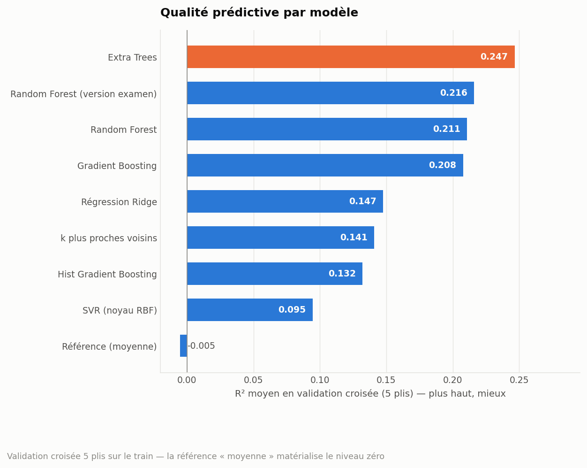
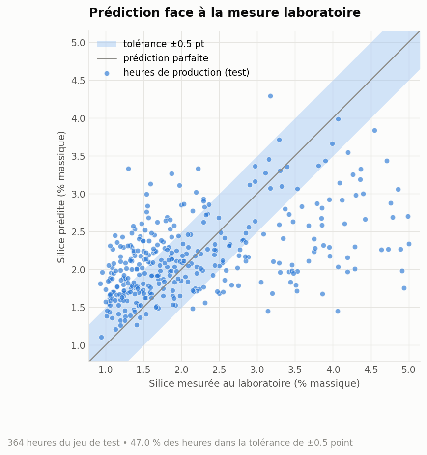
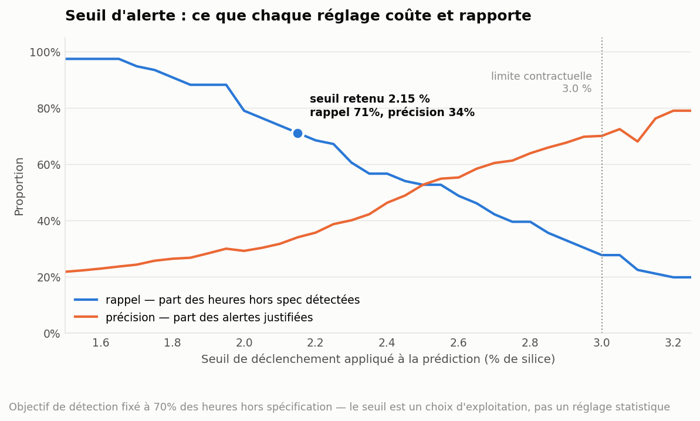
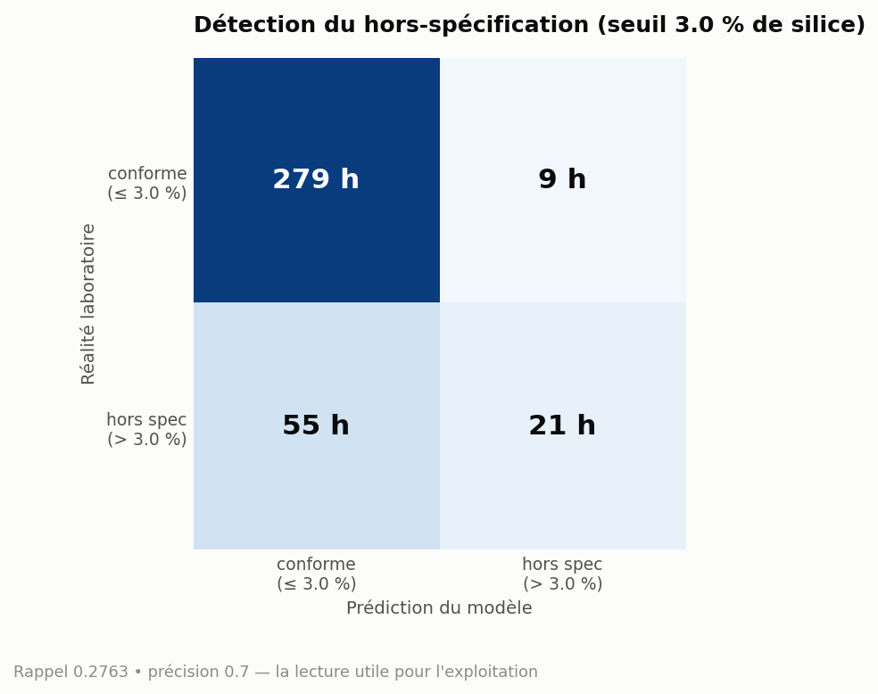
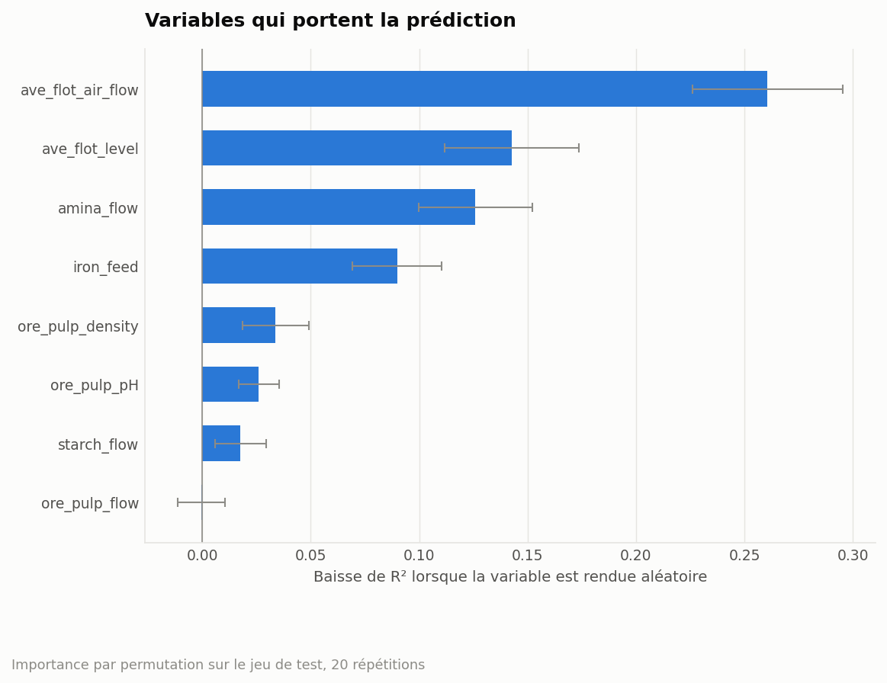

# Prédiction de l'impureté en silice — usine de flottation

> Pipeline ML reproductible qui estime le taux de silice du concentré de fer
> **à partir des capteurs du procédé, sans attendre l'analyse laboratoire** —
> et qui transforme cette estimation en alerte exploitable en salle de contrôle.

[](https://github.com/Ismael-IF/silica-impurity-prediction/actions)
[](https://www.python.org/)
[](https://dvc.org/)
[](LICENSE)

---

## Le problème métier

Dans une usine de flottation, le minerai de fer est débarrassé de sa gangue
siliceuse par ajout de réactifs (amine, amidon) dans des colonnes d'air. Le
concentré vendu à l'aciérie doit respecter une **teneur maximale en silice
inscrite au contrat** : au-delà, le lot est déclassé ou pénalisé.

Le problème est que cette teneur n'est connue que par **analyse laboratoire,
une fois par heure**. Quand le résultat tombe, l'heure de production est déjà
passée : si elle est mauvaise, le minerai est déjà sorti. L'opérateur pilote
donc en aveugle pendant soixante minutes, avec pour seul repère son
expérience — ce qui, statistiquement, revient à parier sur la valeur moyenne.

**Ce projet remplace ce pari par une estimation chiffrée**, calculée à partir
des huit capteurs déjà installés sur la ligne (débit d'air, niveau de mousse,
pH, densité, débits de réactifs, teneur en fer à l'entrée). Aucun capteur
nouveau, aucun investissement matériel : uniquement de l'exploitation de
données existantes.

### La question à laquelle le modèle répond vraiment

Un modèle de régression qui annonce « 2,4 % de silice » n'intéresse personne en
salle de contrôle. La question opérationnelle est binaire :

> **Dois-je corriger le dosage des réactifs maintenant, ou laisser tourner ?**

Tout le projet est construit autour de cette traduction : les métriques
statistiques servent à arbitrer entre deux versions du modèle, mais c'est le
**seuil de déclenchement de l'alerte** qui détermine la valeur réelle.

---

## Résultats

Jeu de test : **364 heures de production** jamais vues à l'entraînement.

| Indicateur | Référence « on prend la moyenne » | Modèle retenu | Écart |
|---|---:|---:|---:|
| RMSE (points de % de silice) | 1,023 | **0,878** | **−14,2 %** d'erreur |
| MAE | — | 0,678 | |
| R² | 0,000 | **0,264** | |
| Heures prédites à ±0,5 point | — | **47 %** | |
| Biais moyen | — | +0,001 | modèle non biaisé |

Le modèle retenu (**Extra Trees**, hyperparamètres issus d'une recherche sur
grille en validation croisée) fait **mieux que le modèle rendu à l'examen**
(Random Forest : R² 0,216 en validation croisée contre 0,247) et nettement
mieux que la référence.



### Le résultat le plus utile n'est pas le R²

Un R² de 0,26 est modeste, et il faut le dire franchement : avec huit mesures
agrégées à l'heure et sans historique temporel, le signal disponible est
limité. Mais la valeur d'exploitation ne se lit pas là.



Le nuage montre le comportement classique d'un modèle de régression : il
**tire ses prédictions vers la moyenne** et écrase les extrêmes. Conséquence
directe, et c'est le point qu'un pilotage naïf raterait :

> Si l'on déclenche l'alerte dès que la *prédiction* dépasse la limite
> contractuelle de 3 %, on ne détecte que **21 des 76 heures réellement hors
> spécification** — 72 % des lots problématiques passent sans alerte.

Le seuil d'alerte n'est donc pas la limite contractuelle : c'est un **réglage
d'exploitation à calibrer**.



En abaissant le déclenchement à **2,15 %**, le modèle détecte **54 des 76
heures hors spécification (71 %)**, au prix de 105 fausses alertes sur 288
heures conformes. L'arbitrage se tranche avec le coût réel de chaque côté :

- **une alerte manquée** = un lot potentiellement déclassé ;
- **une fausse alerte** = une correction de dosage inutile (coût réactif,
  quelques minutes d'opérateur).

Tant que la première coûte nettement plus cher que la seconde, le réglage bas
est le bon. L'objectif de détection est un paramètre de configuration
(`evaluation.alert_recall_target`) : le changer et relancer le pipeline
recalcule le seuil et les figures, sans toucher une ligne de code.



### Ce que le modèle regarde



Le débit d'air de flottation et le niveau de mousse ressortent en tête — ce qui
est cohérent avec la physique du procédé : ce sont les deux leviers qui pilotent
directement l'entraînement des particules de silice vers la mousse.

---

## Architecture du pipeline

Six étapes déclarées dans [`dvc.yaml`](dvc.yaml). DVC construit le graphe de
dépendances et **ne réexécute que ce qui est réellement affecté** par un
changement : modifier le seuil d'alerte ne réentraîne pas le modèle, modifier
la taille du jeu de test reconstruit tout.

```
data/raw/raw.csv
      │
      ▼
   [split] ──────────► X_train, X_test, y_train, y_test
      │
      ▼
 [normalize] ────────► jeux centrés-réduits + scaler.joblib
      │
      ├──► [tune] ───► best_params.json   (recherche sur grille, 5 plis)
      │        │
      │        ▼
      ├──► [train] ──► model.joblib
      │        │
      │        ▼
      ├──► [evaluate] ► metrics.json, business_metrics.json, 5 figures
      │
      └──► [benchmark] ► comparaison des 9 familles de modèles
```

| Fichier | Rôle |
|---|---|
| [`params.yaml`](params.yaml) | Source de vérité unique : aucun réglage n'est codé en dur |
| [`src/config.py`](src/config.py) | Résolution des chemins, journaux UTF-8 multiplateforme |
| [`src/registry.py`](src/registry.py) | Registre des modèles : changer d'estimateur = changer une ligne de config |
| [`src/viz.py`](src/viz.py) | Feuille de style unique pour toutes les figures |
| [`metrics/`](metrics) | Métriques versionnées dans Git, comparables via `dvc metrics diff` |

---

## Démarrage

```bash
git clone https://github.com/Ismael-IF/silica-impurity-prediction.git
cd silica-impurity-prediction
pip install -r requirements-dev.txt
dvc repro
```

Le jeu de données brut est versionné dans le dépôt (334 Ko) : **le pipeline
tourne de bout en bout dès le clone**, sans accès au stockage distant.

```bash
dvc metrics show          # métriques de la version courante
dvc metrics diff          # écart avec le dernier commit
pytest                    # 33 tests
ruff check src tests      # style
```

### Stockage distant

Les artefacts lourds (jeux normalisés, modèle entraîné) sont poussés vers un
stockage S3 hébergé sur DagsHub. Les identifiants ne sont **jamais** dans le
dépôt : ils vivent dans `.dvc/config.local`, ignoré par Git.

```bash
dvc remote modify --local dagshub access_key_id <votre_jeton>
dvc remote modify --local dagshub secret_access_key <votre_jeton>
dvc push
```

Pour travailler hors ligne, un stockage local est préconfiguré :
`dvc remote default local`.

---

## Documentation

| Document | Contenu |
|---|---|
| [Cas métier](docs/01-cas-metier.md) | Le procédé, pourquoi l'analyse horaire arrive trop tard, et pourquoi le seuil d'alerte est une décision économique |
| [Architecture](docs/02-architecture.md) | Graphe de dépendances, décisions d'ingénierie, et le détail de ce qui a changé depuis le rendu d'examen |
| [Fiche modèle](docs/03-model-card.md) | Usage prévu et hors périmètre, données, performances, limites |
| [Résultats détaillés](docs/04-resultats.md) | Benchmark des 9 modèles, réglage, balayage du seuil, et **ce qui a été tenté sans succès** |

---

## Choix techniques et arbitrages

**Pourquoi Extra Trees plutôt que Random Forest.** Le benchmark compare neuf
familles sur le même protocole (validation croisée 5 plis, jeu d'entraînement
uniquement). Extra Trees gagne 0,03 de R² sur Random Forest et, surtout,
présente un écart-type inter-plis plus faible (0,047 contre 0,057) : à
performance voisine, le modèle le plus stable est préférable en production.

**Le scaler est sérialisé.** Un modèle entraîné sur des données centrées-réduites
est inutilisable en production sans le scaler qui a servi à l'entraînement.
`models/scaler.joblib` est produit par l'étape de normalisation et testé :
rejouer la transformation doit redonner exactement les données d'entraînement.

**La recherche sur grille alimente réellement l'entraînement.** Les
hyperparamètres trouvés sont écrits sur disque et relus par l'étape suivante,
avec un test qui vérifie que le modèle entraîné porte bien les paramètres
trouvés. Un repli sur `params.yaml` permet d'exécuter le pipeline en CI sans
payer le coût de la recherche.

**Aucune fuite de données.** Le découpage précède toute transformation ; le
scaler est ajusté sur le train seul ; le benchmark et la recherche sur grille
ne voient jamais le jeu de test. Trois tests protègent explicitement ces
propriétés.

**Le feature engineering métier a été tenté et écarté.** Ratios
amine/amidon, air/niveau, réactif/débit de pulpe, écart de pH à la consigne :
aucun n'améliore la validation croisée (Extra Trees passe de 0,247 à 0,239).
Un résultat négatif, mais mesuré — et donc conservé plutôt que caché.

---

## Limites et suite

- **Le plafond de performance vient des données, pas du modèle.** Les huit
  variables sont des moyennes horaires ; la corrélation linéaire la plus forte
  avec la cible plafonne à 0,23. Le gain principal viendrait des **mesures
  brutes à 20 secondes et de variables décalées dans le temps** (état du
  procédé aux heures précédentes), absentes de ce jeu.
- **Pas d'ordre temporel disponible.** La colonne d'horodatage n'est pas
  exploitable ici, ce qui interdit une validation croisée temporelle — le
  protocole retenu suppose les heures indépendantes, hypothèse discutable sur
  un procédé continu.
- **Pas encore de service de prédiction.** L'étape suivante naturelle est une
  API de scoring et un conteneur, pour que le modèle soit interrogeable depuis
  le système de supervision de l'usine.
- **Pas de surveillance de dérive.** Un changement de minerai ou de réactif
  déplacerait la distribution des capteurs ; un suivi des entrées serait
  nécessaire avant tout usage réel.

---

## Origine du projet

Ce dépôt est la reprise d'un examen MLOps (DataScientest, certification
Machine Learning Engineer) que j'ai entièrement repris pour en faire un projet
présentable : chemins absolus supprimés, configuration extraite du code,
recherche sur grille réellement branchée au pipeline, scaler persisté,
benchmark de modèles, traduction des métriques en indicateurs d'exploitation,
tests et intégration continue.

Le modèle rendu à l'examen est conservé dans le benchmark sous le nom
*Random Forest (version examen)* : il sert de point de comparaison honnête
pour mesurer ce que la reprise a réellement apporté.

**Jeu de données** — 1 817 heures de production d'une usine de flottation,
dérivé de *Quality Prediction in a Mining Process*. Le fichier
`data/raw/raw.csv` a été reconstitué à partir du cache DVC du rendu d'origine
(les quatre jeux découpés, recomposés) ; la colonne d'horodatage, supprimée
par le pipeline, n'y figure pas.

---

## Auteur

**Ismael Foudjo** — Machine Learning Engineer
Sous licence [MIT](LICENSE).
