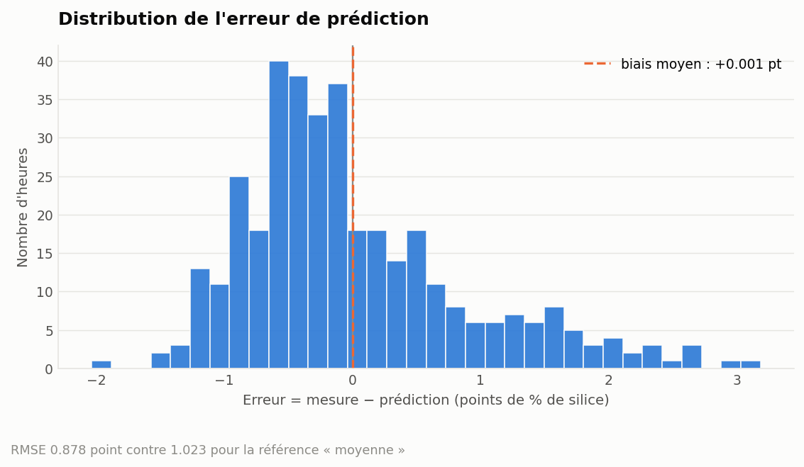

# Résultats détaillés

Tous les chiffres de cette page sont produits par le pipeline et versionnés
dans [`metrics/`](../metrics). Ils se régénèrent avec `dvc repro`.

## Protocole

| | |
|---|---|
| Sélection du modèle | validation croisée 5 plis, **jeu d'entraînement uniquement** |
| Réglage des hyperparamètres | recherche sur grille, même protocole |
| Évaluation finale | jeu de test, utilisé **une seule fois** |
| Graine | 42 partout |

Le jeu de test n'intervient ni dans le benchmark, ni dans la recherche sur
grille. Il n'est ouvert qu'à l'étape `evaluate`.

## Étape 1 — Choisir une famille de modèles

Neuf candidats, même protocole, même jeu de données normalisé.

| Modèle | R² moyen | Écart-type | RMSE moyen |
|---|---:|---:|---:|
| **Extra Trees** | **0,247** | 0,047 | **0,912** |
| Random Forest (configuration initiale) | 0,216 | 0,057 | 0,930 |
| Random Forest | 0,211 | 0,055 | 0,933 |
| Gradient Boosting | 0,208 | 0,054 | 0,935 |
| Régression Ridge | 0,147 | 0,039 | 0,970 |
| k plus proches voisins | 0,141 | 0,050 | 0,974 |
| Hist Gradient Boosting | 0,132 | 0,075 | 0,978 |
| SVR (noyau RBF) | 0,095 | 0,085 | 0,999 |
| Référence (moyenne) | −0,005 | 0,006 | 1,053 |

### Lecture

**La référence matérialise le niveau zéro.** Son R² légèrement négatif est
normal : prédire la moyenne du pli d'entraînement sur le pli de validation fait
marginalement moins bien que prédire la moyenne de ce pli. C'est le repère
contre lequel tout le reste se mesure.

**Les modèles linéaires plafonnent à 0,15.** Cohérent avec les corrélations
linéaires, qui ne dépassent pas 0,24. La relation entre capteurs et silice est
non linéaire.

**Les ensembles d'arbres dominent, et Extra Trees se détache.** Son avantage
tient à sa stratégie : là où Random Forest cherche le meilleur seuil de coupe
sur chaque variable, Extra Trees en tire un au hasard. Sur un signal faible et
bruité, ce surcroît d'aléa limite le sur-apprentissage — ce que confirme son
écart-type inter-plis, le plus faible des quatre ensembles (0,047 contre 0,055
à 0,057).

**Hist Gradient Boosting déçoit** (0,132) avec le plus fort écart-type (0,075).
Il est conçu pour les gros volumes ; sur 1 453 observations, son binning des
variables continues détruit plus d'information qu'il n'en exploite.

> À performance voisine, le modèle le plus stable est préférable : c'est celui
> dont la performance en production ressemblera le plus à celle mesurée ici.

## Étape 2 — Régler Extra Trees

Grille de 16 combinaisons, 5 plis, soit 80 entraînements.

| Hyperparamètre | Valeurs testées | Retenu |
|---|---|---|
| `n_estimators` | 300, 600 | **600** |
| `max_depth` | illimité, 20 | **20** |
| `min_samples_leaf` | 1, 2 | **1** |
| `max_features` | 1.0, 0.6 | **0,6** |

**R² en validation croisée : 0,247 → 0,260.**

Les deux réglages qui comptent vont dans le même sens : limiter la profondeur
à 20 et ne tirer que 60 % des variables à chaque coupe réduisent tous deux la
variance. Sur un signal faible, contraindre le modèle paie plus que le
complexifier.

## Étape 3 — Évaluation finale

364 heures de test, jamais vues.

| Métrique | Référence « moyenne » | RF configuration initiale | **Extra Trees réglé** |
|---|---:|---:|---:|
| RMSE | 1,023 | 0,888 | **0,878** |
| MAE | — | 0,688 | **0,678** |
| R² | 0,000 | 0,248 | **0,264** |

Le gain sur la configuration initiale est réel mais modeste : **+0,016 de R²**, soit
1 % d'erreur en moins. L'essentiel de la valeur du projet n'est pas là.

### Comportement de l'erreur

| | |
|---|---:|
| Biais moyen | +0,001 point |
| Erreur absolue médiane | 0,54 point |
| Erreur absolue au 90ᵉ centile | 1,44 point |
| Heures prédites à ±0,5 point | 47 % |

Distribution centrée et à peu près symétrique : le modèle n'est pas biaisé. Mais
la queue est lourde — une heure sur dix est ratée de plus de 1,4 point, sur une
cible dont l'écart-type n'est que de 1,05.

Ce nuage est le graphique le plus instructif du projet. Le motif en éventail
aplati — points au-dessus de la diagonale à gauche, en dessous à droite —
montre que **le modèle écrase les extrêmes**. Quand le laboratoire mesure 5 %,
le modèle annonce rarement plus de 3 %.

C'est structurel : minimiser l'erreur quadratique pousse à prédire vers la
moyenne. Et c'est exactement ce qui invalide le réglage d'alerte naïf.

### Où le modèle puise son signal

Importance par permutation sur le jeu de test (20 répétitions) : on mesure la
perte de R² quand on brouille une variable. Contrairement à l'importance par
impureté, cette méthode ne surestime pas les variables à forte cardinalité.

Le débit d'air de flottation et le niveau de mousse arrivent en tête, ce qui
est cohérent avec la physique du procédé : ce sont les deux leviers qui
pilotent directement l'entraînement des particules de silice vers la mousse.

> **Attention** — corrélation n'est pas causalité. Ces importances disent où le
> modèle trouve du signal, pas ce qui cause la silice.

## Étape 4 — Du R² à la décision

76 des 364 heures de test dépassent réellement la limite contractuelle de 3 %.

### Le réglage naïf échoue

Alerter quand la *prédiction* dépasse 3 % :

| | Détectées | Manquées | Fausses alertes |
|---|---:|---:|---:|
| Seuil 3,00 % | 21 | **55** | 9 |

Rappel 28 %, précision 70 %. **Presque trois quarts des heures problématiques
passent sans alerte** — conséquence directe de l'écrasement des extrêmes.

Un projet qui s'arrêterait au R² livrerait ce réglage sans s'en apercevoir.

### Le seuil est un curseur

| Seuil | Alertes levées | Détectées | Manquées | Fausses alertes | Rappel | Précision |
|---:|---:|---:|---:|---:|---:|---:|
| 1,80 % | 262 | 69 | 7 | 193 | 91 % | 26 % |
| 2,00 % | 206 | 60 | 16 | 146 | 79 % | 29 % |
| **2,15 %** | **159** | **54** | **22** | **105** | **71 %** | **34 %** |
| 2,30 % | 115 | 46 | 30 | 69 | 61 % | 40 % |
| 2,50 % | 76 | 40 | 36 | 36 | 53 % | 53 % |
| 2,70 % | 53 | 32 | 44 | 21 | 42 % | 60 % |
| 3,00 % | 30 | 21 | 55 | 9 | 28 % | 70 % |

Le balayage complet est dans
[`metrics/alert_threshold_sweep.json`](../metrics/alert_threshold_sweep.json).

### Le réglage retenu

Objectif fixé à **70 % de détection**. La règle implémentée retient le seuil
**le plus haut** qui atteigne encore cet objectif : parmi les réglages qui
tiennent la promesse faite à l'exploitation, c'est celui qui lève le moins de
fausses alertes.

**Résultat : 2,15 %** — 54 heures détectées sur 76, 105 fausses alertes.

Passer de 21 à 54 heures détectées, c'est **2,6 fois plus de lots
problématiques signalés à temps**, sans changer une ligne du modèle. Le gain ne
vient pas de l'algorithme mais de la traduction en règle de décision.

L'objectif se pilote par `evaluation.alert_recall_target` : le changer et
relancer `dvc repro` recalcule seuil, métriques et figures.

## Ce qui a été tenté sans succès

Un portfolio honnête montre aussi ce qui n'a pas marché.

### Variables métier dérivées

Cinq variables construites à partir de la physique du procédé : ratio
amine/amidon, ratio air/niveau de mousse, réactif total rapporté au débit de
pulpe, produit fer × densité, écart absolu du pH à sa consigne.

| Modèle | Sans | Avec |
|---|---:|---:|
| Extra Trees | 0,247 | 0,239 |
| Random Forest (initial) | 0,216 | 0,206 |
| Hist Gradient Boosting | 0,132 | 0,152 |

**Aucun gain, et même une légère dégradation** sur les deux meilleurs modèles.
Explication plausible : un ensemble d'arbres sait déjà construire ces
interactions par découpes successives ; les ajouter ne fait que diluer le
signal sur plus de variables, ce qui pénalise un échantillon de 1 453
observations.

### Transformation logarithmique de la cible

La cible est asymétrique à droite, ce qui justifiait d'essayer. R² en
validation croisée : **0,250 contre 0,260**. Pas de gain.

### Agrégation de modèles

Vote moyen entre Extra Trees, Random Forest et Gradient Boosting : **0,248**,
en dessous d'Extra Trees seul réglé. Les trois modèles se trompent sur les
mêmes heures — agréger des erreurs corrélées n'apporte rien.

## Conclusion

| Levier | Gain en R² |
|---|---:|
| Changer de famille de modèle (RF → Extra Trees) | +0,031 |
| Régler les hyperparamètres | +0,013 |
| Variables métier dérivées | −0,008 |
| Transformation de la cible | −0,010 |
| Agrégation de modèles | −0,012 |

Le plafond atteint est **celui des données, pas celui du modèle**. Huit
moyennes horaires, aucune variable décalée dans le temps, aucune dynamique
intra-horaire : le signal disponible est borné, et aucune astuce de modélisation
ne le contourne.

Dans ces conditions, le travail utile n'était pas de gratter du R² mais de
**transformer un signal faible en décision exploitable** — ce que fait la
calibration du seuil d'alerte, qui multiplie par 2,6 le nombre de lots
problématiques détectés.

La suite la plus prometteuse n'est pas algorithmique : ce sont les **mesures
brutes à 20 secondes et des variables décalées**, qui donneraient au modèle ce
qui lui manque réellement.
